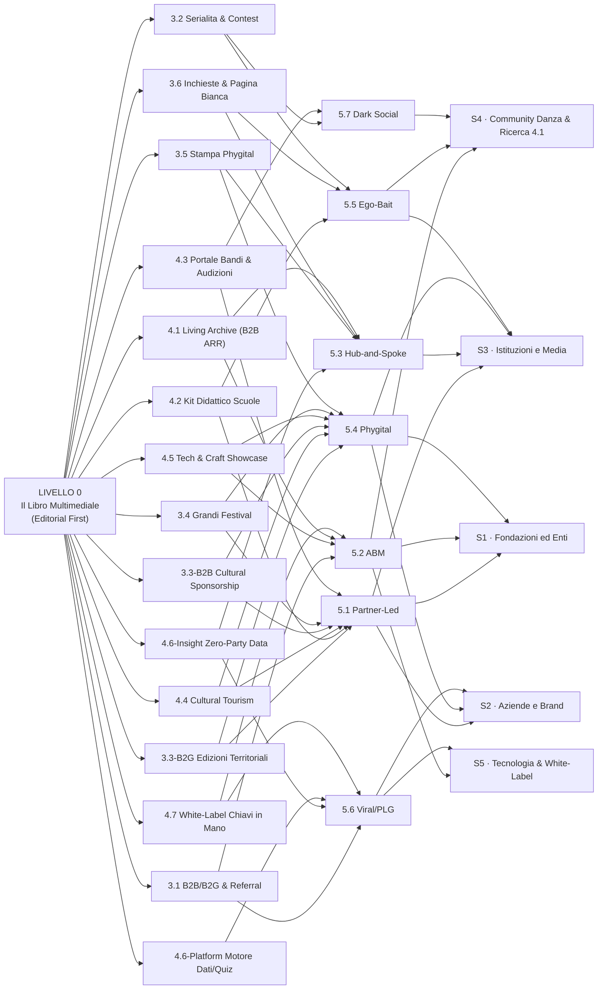

# Skill `model-business`: Calibrazione Trasparente del Business Model e dei Flussi di Valore per Ecosistemi Editoriali Multimediali

## 1. Scopo e Regola d'Oro della Calibrazione

Questa skill accompagna e completa `doc/premium-multimedia-ebook-skill` (`multimedia-book-dance-ecosystem` v1.1.0). Mentre la prima skill definisce l'architettura editoriale e narrativa del sito web (*"Editorial First, Business by Design"*), la skill **`model-business`** traduce quella strategia in un **modello economico-finanziario verificabile e calibrabile** per la startup promotrice (**Innovation Multimedial** / *Finestre sulla Danza*) e per i suoi **5 Stakeholder principali di Livello 3**.

### Principio Non Negoziabile: "Editorial First, Financial Rigor by Design"

Per passare da indicatori indicativi da landing page a un **Business Case specifico** difendibile davanti a founder, investitori, fondazioni e sponsor, ogni calibrazione deve rispettare quattro regole contabili e metodologiche:

1. **Separazione dei flussi della Startup da quelli degli Stakeholder:** Un indotto turistico, una borsa di studio raccolta dal pubblico o un *Earned Media Value* sono benefici **dello Stakeholder o del Territorio**, mai ricavi della Startup.
2. **Separazione Cash vs Barter vs Pass-Through:** Le forniture tecniche in cambio merce (*barter*) riducono i costi di produzione se e solo se sostituiscono spese reali previste a budget; non possono essere sommate ai ricavi cash senza esplicitazione. I fondi raccolti per borse di studio (*"dona con il voto"*) sono partite di giro etiche a ricavo zero per la Startup.
3. **Coerenza dell'orizzonte temporale:** I ricavi cumulati a 24 mesi non vanno mai sommati con metriche istantanee annualizzate (*ARR run-rate* di fine periodo) senza esplicitare la curva di ramp-up Anno 1 + Anno 2 e i rinnovi.
4. **Costi integrali e funnel deduplicati:** Nessun CAC, K-factor o margine operativo ha valore decisionale se non esplicita costi fissi di piattaforma, produzione redazionale, costi commerciali ABM, saturazione della rete virale e sovrapposizione delle audience tra canali.

> [!IMPORTANT]
> Per ricalcolare qualsiasi scenario con parametri personalizzati della startup, utilizza il simulatore deterministico allegato in [calibrate_business_case.py](./scripts/calibrate_business_case.py) e consulta l'audit granulare di tutti i 26 KPI del sito in [kpi-audit-matrix.md](./references/kpi-audit-matrix.md).

---

## 2. Audit Approfondito del Sito Realizzato (Analisi A-1)

L'analisi incrociata tra `doc/premium-multimedia-ebook-skill` e il codice sorgente pubblicato (`src/data/content.ts`, `src/components/Impact.tsx`, `src/components/EcosystemMap.tsx`, `src/components/Stakeholders.tsx`, `src/components/Pricing.tsx`, `src/components/Engines.tsx`, `src/components/Reader.tsx`) rivela che i parametri del sito sono **indicatori sintetici di output/risultato** costruiti su calcoli impliciti non documentati e affetti da **10 criticità di trasparenza e riconciliazione**.

### 2.1 Le 10 Assunzioni Implicite e Incongruenze Scoperte nel Sito

| # | Area / Modulo | Cosa mostra il Sito | Logica Implicita Ricostruita | Criticità / Ambiguità per il Business Case |
| :- | :--- | :--- | :--- | :--- |
| **1** | **Mix Ricavi 24M** (`Impact.tsx`, `4.5`) | `€1.520.000` di "ricavi non diluitivi" (`€500k` B2B/B2G + `€360k` Tech + `€240k` Cultural + `€240k` ARR + `€180k` White-Label) | Il `30%` di `€360k` (`€108.000`) è dichiarato nel modulo `4.5` come **barter tecnico**, ma viene incluso interamente nei ricavi monetari aggregati. | **Sovrastima cash di `€108.000`:** il cash reale su quella riga è `€252.000` (`70%`), non `€360.000`. |
| **2** | **Living Archive** (`4.1` vs `Impact.tsx`) | `€240.000` ("`80 licenze × €3.000`"), definito `ARR` (ricavo ricorrente *annuale*) | Somma `€240k` dentro un grafico etichettato *"24 mesi"*, mentre il target a 24 mesi indicato nel modulo è `€400k`. | **Errore temporale:** con 20 licenze in Y1 (`€60k`) e 80 attive in Y2 (`€240k` Exit ARR), il cash cumulato 24M è **`€300.000`**, non `€240k`. Manca inoltre nella sezione `Pricing`. |
| **3** | **White-Label** (`4.7` vs `Pricing.tsx`) | `€180.000` in `revenueMix`, `8 commesse` in `4.7`, listino *"da €45.000 per progetto"* | `€180.000 / 8 = €22.500` per commessa (metà del prezzo di listino) oppure `4 commesse × €45.000 = €180.000`. | **Incongruenza di fattore `2×`:** `8 × €45.000` genererebbe **`€360.000`**. Vanno separati due tier (*Sprint Co-Branded* `€24k` vs *Enterprise White-Label* `€45k`). |
| **4** | **B2B/B2G ACV vs Listino** (`3.1` vs `Pricing.tsx`) | `ACV = €12.500` (`= 520× €24`), ma piano `Istituzionale` a `€9.800` (`1.000` licenze, `20` classi) | `40 contratti × €12.500 = €500.000`. Il prezzo medio `€12.500` presuppone `+€2.700` medi di upsell (moduli `4.2`/`4.4`/`3.3`) rispetto al base `€9.800`. | Il costo unitario implicito per licenza passa da `€24,00` (`3.1`) a `€9,80` (`Pricing`, sconto volume `59%`), e le `300` classi oltre le `800` base (`40×20`) non hanno un listino esplicito. |
| **5** | **Costi Completi Assenti** (`Impact.tsx`, `3.4`, `3.6`) | Mostra ricavi (`€1,52M`), CAC (`€0,40`) e margine marginale White-Label (`62%`) | Mancano completamente Capex piattaforma, redazione fissa, team commerciale ABM, costi di produzione di `3.4` (offerto *"a costo zero"* al festival) e `3.6` (inchieste). | Impossibile calcolare **EBITDA**, **fabbisogno di cassa Anno 1** e **Break-Even** dai soli dati pubblicati. |
| **6** | **K-Factor `1,35` non smorzato** (`3.1`, `5.6`, `Hero`) | `K = 1,35` ("nuovi lettori generati in media da ogni lettore iniziale") | $K = i \times c$ (es. `3 inviti × 45%` conversione). Se applicato senza limite in un modello geometrico ($K > 1$), la popolazione diverge all'infinito. | Nella calibrazione reale `1,35` va trattato come **tasso di prima ondata di coorte** soggetto a decadimento di rete ($\lambda$) per sovrapposizione delle community chiuse. |
| **7** | **CAC `€0,40` parziale** (`5.1`, `Hero`, `Impact`) | `€0,40` per lettore attivo contro `€6,50` paid social | Implica `180.000 × €0,40 = €72.000` di spesa diretta (`650` punti phygital `× €40` = `€26k` + `€46k` media kit/seeding/landing). | Esclude i costi fissi del team ABM/Sales e della redazione che abilita i partner (`3.4`, `3.5`). Vanno distinti **CAC Diretto di Distribuzione** e **CAC Fully-Loaded**. |
| **8** | **Lead B2B `€18` ambiguo** (`4.5`) | `640 lead B2B`, nota `"Costo per lead stimato: €18"` | `640 × €18 = €11.520` (costo marginale interno della Startup per acquisire/instradare i lead, oppure errore concettuale rispetto al CPL sostenuto dallo sponsor). | Per lo sponsor tecnico che investe `€25k–€30k`, il CPL implicito è `~€470–€560/lead` (ma include brand affinity `11,5 min` e asset video, restando competitivo verso le fiere). |
| **9** | **Confusione Buyer/Fruitore & Moduli Ibridi** (`3.3`, `4.1`, `4.6`) | `3.3` è condiviso tra `fondazioni` e `aziende`; `4.6` tra `aziende` e `tecnologia`; `4.1` è assegnato solo a `community` | In `4.1` gli utenti sono professionisti/studiosi, ma chi paga `€3.000/anno` sono università, biblioteche e osservatori; in `3.3` i flussi B2G e B2B hanno KPI unificati (`27%`, `11,5 min`). | Impedisce di formulare offerte commerciali e account plan separati per ciascun decisore economico. |
| **10** | **Topologia `54` vs `55` Connessioni & Archi Omessi** (`EcosystemMap.tsx`) | Etichetta UI `"55 connessioni"` | Il grafo reale in `content.ts` contiene `13 (L0->L1) + 26 (L1->L2) + 15 (L2->L3) = 54` archi; inoltre `computeHighlight` filtra via i motori secondari di modulo non elencati in `s.engines` (es. `5.6` su `3.1`, `5.5` su `4.2`, `5.2` su `4.5`). | Nella lettura strategica vanno reintegrati anche i motori secondari che alimentano indirettamente i flussi di valore verso ciascuno stakeholder. |

### 2.2 Equazioni Implicite Ricostruite dalle Scale Grafiche del Sito

Analizzando `ratio` e `baseRatio` di tutti i 26 KPI in `src/data/content.ts` (vedi tabella integrale in [kpi-audit-matrix.md](./references/kpi-audit-matrix.md)), emergono i tetti di scala e le relazioni interne implicite usate dal sito:

- **Zero-Party Profiles (`4.6`):** $\text{Profili} = 180.000 \text{ lettori} \times 0,875 \text{ (dedup utenti)} \times 58\% \text{ (survey)} \times 46\% \text{ (opt-in)} = \mathbf{42.021} \approx 42.000$.
- **Prenotazioni Turistiche (`4.4`):** $10 \text{ destinazioni} \times 4.800 \text{ attivazioni} \times 22\% \text{ CTR} = \mathbf{10.560} \approx 10.500$ (su `220` strutture = `218` attivazioni/struttura in 24M).
- **Borse di Studio (`3.2`):** $12 \text{ tappe} \times 4.000 \text{ voti/tappa} = 48.000 \text{ voti}$; a `€1/voto` (o `50%` donanti `€2` come in `Reader.tsx`) = `€48.000` $\rightarrow$ `48` borse da `€1.000` (`4` borse/tappa).
- **Earned Media Value (`3.4`):** $\text{EMV} = 350.000 \text{ utenti unici} \times €1,20/\text{utente equivalente} = \mathbf{€420.000}$ per speciale; Pipeline `12 trattative / 45 contatti = 26,67%` $\approx 27\%$.
- **Attivazioni Stampa (`3.5`):** $180.000 \text{ copie} \times 14\% \text{ QR-to-Digital} = \mathbf{25.200}$ accessi digitali.
- **Margine White-Label (`4.7`):** $\text{Costo marginale} = 38\% \Rightarrow \text{Ricavo}/\text{Costo} = 1 / 0,38 = 2,63\times \approx 2,6\times \Rightarrow \text{Margine} = \mathbf{62\%}$.

---

## 3. Modello Matematico Esplicito per la Calibrazione (Analisi B-1)

Per calibrare il Business Case specifico della startup su un orizzonte di **24 mesi** ($Y_1$ = Lancio & Pilota; $Y_2$ = Scala & Rinnovi), ogni parametro di input alimenta cinque blocchi di calcolo trasparenti.

### 3.1 Blocco A — Funnel Audience Deduplicato e Viralità Smorzata

Sia $R_{\text{lordo}}$ la somma delle esposizioni su tutti i canali (CRM enti/sponsor, licenze dirette, utenti festival, copie stampa, attivazioni turistiche, semi organici community). Applicando il fattore di sovrapposizione inter-canale $\delta_{\text{overlap}} \in [0,15; 0,30]$:

$$R_{\text{unica}} = R_{\text{lordo}} \cdot (1 - \delta_{\text{overlap}})$$

I **Lettori Attivi Primari** (sessione $> 4\text{ min}$, prima della viralità) sono la somma delle conversioni di profondità per singolo canale:

$$L_{\text{primari}} = (\text{Redemption}_{\text{CRM}} + \text{Licenze}_{\text{attive}}) \cdot r_{\text{deep,partner}} + U_{\text{fest}} \cdot r_{\text{deep,fest}} + \text{Scan}_{\text{stampa}} \cdot r_{\text{deep,stampa}} + \text{Attiv}_{\text{tur}} \cdot r_{\text{deep,tur}} + L_{\text{community,seed}}$$

Per evitare la divergenza esponenziale quando $K_{\text{ondata1}} \ge 1$, la propagazione virale (`5.5`, `5.6`, `5.7`) viene modellata come **cascata smorzata su 3 ondate** con decadimento di saturazione $\lambda \in [0,35; 0,55]$:

$$w_1 = K_1, \qquad w_2 = w_1 \cdot (K_1 \cdot \lambda), \qquad w_3 = w_2 \cdot (K_1 \cdot \lambda^2)$$

$$M_{\text{virale}} = 1 + (w_1 + w_2 + w_3) = 1 + K_{\text{net}}, \qquad L_{\text{attivi\_tot}} = L_{\text{primari}} \cdot M_{\text{virale}}$$

I profili **Zero-Party Data (`4.6`)** derivano dai lettori attivi deduplicati ($u_{\text{dedup}} \approx 0,875 - 0,88$):

$$P_{\text{ZPD}} = L_{\text{attivi\_tot}} \cdot u_{\text{dedup}} \cdot r_{\text{survey}} \cdot r_{\text{optin}}$$

### 3.2 Blocco B — Costo di Acquisizione Duale (CAC Diretto vs Fully-Loaded)

$$\text{CAC}_{\text{diretto}} = \frac{N_{\text{punti\_phygital}} \cdot C_{\text{punto}} + C_{\text{seeding\_mediakit}}}{L_{\text{attivi\_tot}}}$$

$$\text{CAC}_{\text{fully\_loaded}} = \frac{N_{\text{punti\_phygital}} \cdot C_{\text{punto}} + C_{\text{seeding\_mediakit}} + C_{\text{sales\_ABM}}}{L_{\text{attivi\_tot}}}$$

### 3.3 Blocco C — Ricavi Cash, Barter Tecnico, Pass-Through e ARR

- **Ricavi Cash Startup (24M):** $\text{Rev}_{\text{cash},24M} = \sum_{y \in \{1,2\}} \left( \text{Rev}_{\text{Fondazioni},y} + \text{Rev}_{\text{CultSpons},y} + \text{Rev}_{\text{TechCash},y} + \text{Rev}_{\text{Archive},y} + \text{Rev}_{\text{FeaturedCall},y} + \text{Rev}_{\text{WhiteLabel},y} \right)$
- **Barter Tecnico Reale (`4.5`):** $\text{Barter}_{24M} = \text{Gross}_{\text{Tech}} \cdot s_{\text{barter}}$, contabilizzato **a riduzione diretta del COGS di produzione tecnica**, mai come cassa entrante.
- **Fondi Pass-Through (`3.2`):** $\text{FondoBorse} = N_{\text{tappe}} \cdot V_{\text{tappa}} \cdot d_{\text{voto}}$, interamente destinato alle borse di studio (`€0` nel P&L Startup).
- **Coerenza Living Archive (`4.1`):** $\text{Rev}_{\text{Archive},24M} = (Q_1 \cdot P_{\text{arr}}) + \left[ (\text{round}(Q_1 \cdot r_{\text{rinnovo}}) + Q_{2,\text{nuove}}) \cdot P_{\text{arr}} \right]$, distinto dall'**Exit ARR** del Mese 24 pari a $(Q_{\text{rinnovate}} + Q_{2,\text{nuove}}) \cdot P_{\text{arr}}$.

### 3.4 Blocco D — Struttura Costi Integrale Startup, EBITDA e Break-Even

$$\text{COGS}_{24M} = \sum_i (\text{Rev}_{\text{cash},i} \cdot c_{\text{var},i}) + \max(0, \text{COGS}_{\text{tech\_lordo}} - \text{Barter}_{24M}) + C_{\text{prod\_3.4\_3.5}} + C_{\text{ops\_community\_4.3}}$$

$$\text{OpexFissi\&Capex}_{24M} = \text{Capex}_{\text{piattaforma}} + C_{\text{redazione\_L0\_3.6}} + C_{\text{sales\_ABM}} + C_{\text{GTM\_phygital\_seeding}} + C_{\text{G\&A\_CDN\_GDPR}}$$

$$\text{EBITDA}_{24M} = (\text{Rev}_{\text{cash},24M} - \text{COGS}_{24M}) - \text{OpexFissi\&Capex}_{24M}, \qquad \text{BreakEven}_{\text{cash},24M} = \frac{\text{OpexFissi\&Capex}_{24M}}{\text{GrossMargin}\%}$$

---

## 4. Flussi di Beneficio Rigorosi sui 4 Livelli (`L0 -> L1 -> L2 -> L3`) (Analisi C-1)

### 4.1 Mappa Topologica Riconciliata (Correzione Sovrapposizioni e Sotto-Flussi)

Per eliminare le ambiguità del sito, i moduli condivisi vengono scissi nei rispettivi **sotto-flussi economici distinti**:
- `3.3` si sdoppia in **`3.3-B2G`** (Edizioni territoriali Comuni/Regioni $\rightarrow$ *Fondazioni ed Enti*) e **`3.3-B2B`** (Cultural Sponsorship CRM brand $\rightarrow$ *Aziende e Brand*).
- `4.6` si sdoppia in **`4.6-Insight`** (Reportistica dati sul pubblico per sponsor $\rightarrow$ *Aziende e Brand*) e **`4.6-Platform`** (Motore nativo quiz/GDPR integrato nella piattaforma replicabile $\rightarrow$ *Tecnologia & White-Label*).
- `4.1` separa il **fruitore/contributor** (*Community Danza*: accesso tramite istituzioni o case study) dal **buyer B2B pagante** (*Università, Biblioteche, Accademie, Osservatori*: licenza annuale `€3.000/anno`).

### 4.2 Matrice di Distinzione dei Benefici a 4 Quadranti (Startup vs 5 Stakeholder)

| Stakeholder L3 | Linee L1 Convergenti | Motori L2 (Primari + Indiretti) | Startup · Benefici Monetari | Startup · Benefici Non Monetari | Stakeholder · Benefici Monetari | Stakeholder · Benefici Non Monetari |
| :--- | :--- | :--- | :--- | :--- | :--- | :--- |
| **1. Fondazioni ed Enti** | `3.1`, `3.3-B2G`, `4.2`, `4.4` | `5.1`, `5.2`, `5.4` *(+ `5.5`, `5.6` ind.)* | Ricavi cash B2B/B2G immediati e non diluitivi (`€9.800–€18.400+`/contratto); rinnovi annuali. | Legittimazione istituzionale, adozione scolastica strutturale, riduzione CAC tramite DB comunali/scolastici. | Acquisto conforme a procurement beni/servizi; CAPEX sviluppo portali risparmiato; indotto turistico/biglietteria (`4.4`). | Impatto ESG/culturale certificato in dashboard (classi PCTO, redemption cittadini, accessi territoriali). |
| **2. Aziende e Brand** | `3.3-B2B`, `4.5`, `4.6-Insight` | `5.1`, `5.4`, `5.6` *(+ `5.2`, `5.3` ind.)* | Fee Cultural Sponsorship cash (`€24k`/cap.); Tech Showcase (`75%` cash + `25%` barter a riduzione costi ripresa/luce). | Dataset proprietario Zero-Party; casi d'uso tecnologici ad alto prestigio estetico; trigger phygital retail/fiere. | Risparmio CPL rispetto a fiere B2B (`€240` vs `€500+`); valore ricerche di mercato evitate (`4.6`); valore media vs adv. invasivo. | Brand affinity elevata (`~11 min` dwell time vs `0,8 min` adv.); riattivazione CRM (`25–27%`); posizionamento da mecenate. |
| **3. Istituzioni e Media** | `3.4`, `3.5`, `3.6` | `5.1`, `5.3`, `5.4`, `5.5` | **€0 diretti**; generazione pipeline B2B (`27%` conv. su contatti) e cross-selling verso `4.7`, Fondazioni e Sponsor. | *Halo effect* da grandi festival; lettori qualificati a `CAC ≈ €0`; autorevolezza civica e citazioni stampa (`3.6`). | Costo di produzione editoriale evitato (`€28k–€35k`/speciale); *Earned Media Value*; supporto vendite/retention abbonati stampa. | Ringiovanimento pubblico; amplification `12×` su cartellone; centralità nel dibattito pubblico (*La Pagina Bianca*). |
| **4. Community Danza & Ricerca `4.1`** | `3.2`, `4.3`, `4.1` *(buyer B2B)* | `5.2`, `5.5`, `5.7` *(+ `5.1`, `5.3` ind.)* | **Ricavi `4.1`:** ARR da licenze B2B (`€3.000/anno` ad atenei/biblioteche/associazioni); **€0** da borse `3.2`; opzionale `4.3` *Featured Calls* (`€350`). | Motore principale di retention (`60–64%`), traffico di ritorno (`MAU`), viralità WhatsApp (`5.7`) e alimentazione quiz `4.6`. | **Fondi borse di studio** mobilitati (`€1.000`/borsa via *"dona con il voto"*); accesso gratuito a bandi/audizioni (`€0` B2C). | Visibilità nazionale per scuole locali; sviluppo carriera danzatori; accesso ad archivio storico/gestionale via enti. |
| **5. Tecnologia & White-Label** | `4.7`, `4.6-Platform` | `5.2`, `5.6` *(+ `5.3` ind.)* | Commesse ad alto margine (`62%` contribuzione su costo marginale `38%`) + canone annuale SaaS/hosting (`€4.500/anno`). | Ammortamento Capex tecnologico L0; acquisizione organica inbound tramite badge *"Powered by"* (`5.6` PLG). | CAPEX sviluppo custom evitato (`€85k–€95k` lordo); margine editoriale `62%` vs `18%` produzione ex novo. | Time-to-market ridotto a **8 settimane**; stack analytics, referral e GDPR Zero-Party chiavi in mano. |

---

## 5. Value Proposition, Modelli di Business e Stime Calibrate per i 5 Stakeholder (Analisi C-2 e C-3)

Di seguito ogni Stakeholder riceve un **Business Model autonomo**, con **assunzioni di mercato esplicite (Italia)**, **Value Proposition**, **architettura di pricing riconciliata** e **indicatori stimati su tre scenari** (*Conservativo 24M*, *Business Case Base Calibrato 24M*, *Benchmark Sito Riconciliato 24M*).

---

### 5.1 Stakeholder 1 — Fondazioni ed Enti Pubblici (`fondazioni`)

#### A. Assunzioni sui Dati (Mercato Italia · 24 Mesi)
- **Universo indirizzabile (TAM/SAM):** 86 Fondazioni di origine bancaria (ACRI) + 20 Regioni/Province autonome + ~120 Comuni capoluogo/Unioni di Comuni/DMO con budget culturale/turistico $\approx \mathbf{226}$ enti target.
- **Capacità commerciale ABM (`5.2`) in 24M (Base):** 72 decisori contattati con cofanetto phygital (`36`/anno) $\rightarrow$ **34% meeting conversion** (`24–25` incontri qualificati) + inbound da rete festival (`+12` incontri) $\rightarrow$ **19 contratti chiusi in 24 mesi** (`6` in Anno 1, `13` in Anno 2).
- **Mix pacchetti riconciliato:**
  - *Tier F1 — Istituzionale Base (`3.1 + 4.2`)*: **€9.800** (`1.000` licenze, prefazione, ex-libris, landing dedicata, `20` classi PCTO) $\rightarrow$ `4` Y1 + `7` Y2 = `11` contratti.
  - *Tier F2 — Edizione Territoriale & Tourism (`3.1 + 3.3-B2G + 4.4`)*: **€14.500** (`2.000` licenze, dossier territoriale borghi/teatri, audio-guide, QR su strutture DMO) $\rightarrow$ `2` Y1 + `4` Y2 = `6` contratti.
  - *Tier F3 — Programma Regionale Annuale (`All-in -20%`)*: **€18.400** (`5.000` licenze, `50` classi, `2` itinerari turistici annuali) $\rightarrow$ `0` Y1 + `2` Y2 = `2` contratti.
- **Parametri operativi Base:** COGS di personalizzazione/pedagogia/mappe = **24%** dei ricavi; CRM/portali comunali su ~42% dei contratti (`8` enti × `10.000` contatti) con redemption **25%**; `6` destinazioni turistiche attive × `4.000` attivazioni = `24.000` accessi, CTR prenotazioni **21%** (`€32` spesa media locale); valore piattaforma/progetto custom evitato dall'ente = **€35.000**.

#### B. Value Proposition Specifica
- **Job-to-be-Done:** Finanziare iniziative culturali, educative (PCTO) e di turismo lento sul territorio superando le rigidità amministrative delle erogazioni a fondo perduto e dimostrando l'impatto agli organi di controllo.
- **Pain Rimosso:** Rischio rendicontativo delle sovvenzioni tradizionali e mancanza di metriche oggettive di fruizione post-contributo.
- **Gain Consegnato:** Acquisto di un **bene culturale e didattico finito** (conforme alle regole di procurement di beni e servizi), co-firmato con ex-libris digitale dell'ente, distribuito in scuole e borghi con **dashboard KPI verificabile**.

#### C. Modello di Business Distinto
- **Segmento:** Segretari Generali e Commissioni Arte/Cultura di Fondazioni; Assessorati Cultura/Turismo/Istruzione; DMO regionali.
- **Offerta & Pricing:** Pacchetti B2B/B2G a prezzo chiuso su tre tier (`€9.800` / `€14.500` / `€18.400`), sconto `-20%` su impegni annuali multi-uscita.
- **Canali & Motori:** ABM chirurgico (`5.2`), distribuzione su portali soci/cittadini e USR (`5.1`), QR/NFC in borghi, info-point e hotel (`5.4`), con amplificazione indiretta via docenti (`5.5`) e referral (`5.6`).
- **Monetizzazione & Costi Startup:** Ricavo **100% cash** immediato e non diluitivo; margine lordo di linea **76%** (`COGS 24%`).

#### D. Indicatori Stimati e Spiegazione della Logica

| Prospettiva / Tipo | Indicatore | Formula Esplicita | Conservativo (24M) | Base Calibrato (24M) | Benchmark Sito Riconciliato |
| :--- | :--- | :--- | :---: | :---: | :---: |
| Startup · Monetario | **Contratti chiusi (Y1 + Y2)** | $\sum (F_1 + F_2 + F_3)$ | `12` (`4+8`) | **`19`** (`6+13`) | `40` (`13+27`) |
| Startup · Monetario | **ACV medio contratti B2B/B2G** | $\text{Ricavi}_{\text{Fond}} / N_{\text{contratti}}$ | `€11.692` | **`€12.189`** | `€12.505` *(vs €12.500)* |
| Startup · Monetario | **Ricavi Cash Startup (24M)** | $F_1 P_1 + F_2 P_2 + F_3 P_3$ | `€140.300` | **`€231.600`** | `€500.200` *(vs €500k)* |
| Startup · Monetario | **Margine Lordo di Linea (76%)** | $\text{Ricavi} \times (1 - c_{\text{var}})$ | `€105.225` *(75%)* | **`€176.016`** | `€380.152` |
| Startup · Non Mon. | **Redemption sui DB Partner** | $\text{Download} / \text{Invii DB partner}$ | `20,0%` | **`25,0%`** | `27,0%` *(vs 3% DEM)* |
| Stakeholder · Mon. | **CAPEX Portali/Progetti Risparmiato** | $N_{\text{contratti}} \times €35\text{k–}€40\text{k}$ | `€360.000` | **`€665.000`** | `€1.600.000` |
| Stakeholder · Mon. | **Indotto Prenotazioni Locali (`4.4`)** | $\text{Attivazioni} \times \text{CTR} \times €32$ | `€48.384` (`1.728` pren.) | **`€161.280`** (`5.040` pren.) | `€337.920` (`10.560` pren.) |
| Stakeholder · Non Mon. | **Istituti e Classi Adottanti (`4.2`)** | $(F_1 \cdot s_1 + F_3 \cdot s_3) \times 3,45\text{ cl.}$ | `82` ist. / `279` cl. | **`134` ist. / `462` cl.** | `320` ist. / `1.101` cl. |
| Stakeholder · Non Mon. | **Attivazioni Turistiche (`4.4`)** | $N_{\text{dest}} \times \text{Attiv/dest}$ | `9.600` (`3` dest.) | **`24.000`** (`6` dest.) | `48.000` (`10` dest.) |

**Logica utilizzata:** Riconcilia il prezzo d'ingresso `€9.800` del listino con l'ACV `€12.500` del modulo `3.1` tramite l'upsell ai pacchetti territoriali `F2`/`F3` (`3.3-B2G` e `4.4`). Separa nettamente il ricavo cash della Startup (`€231.600` nel Base Case) dall'indotto turistico locale generato per operatori e biglietterie del territorio (`€161.280`), evitando che l'impatto economico del territorio venga confuso con il fatturato aziendale.

---

### 5.2 Stakeholder 2 — Aziende e Brand (`aziende`)

#### A. Assunzioni sui Dati (Mercato Italia · 24 Mesi)
- **Universo indirizzabile:** ~350 brand lifestyle/wellness/moda/sostenibilità attivi nella comunicazione culturale (*Cultural Sponsorship `3.3-B2B`*) + ~180 aziende leader della filiera tecnica/health/scena (pavimentazioni danza, illuminotecnica, acustica, tessuti tecnici, fisioterapia sportiva, attrezzature AV — *Tech Showcase `4.5`*).
- **Volumi 24M (Base):**
  - `3.3-B2B` Cultural Sponsorship: `2` capitoli in Y1 (`€24.000` cad.) + `3` capitoli in Y2 (`€21.600` blended con sconto `-20%` sui programmi annuali) = **5 capitoli** (`€112.800` cash). Lista CRM media inviata per sponsor = `26.000` contatti, redemption `25%`.
  - `4.5` Tech & Craft Showcase: `2` partner Y1 + `4` partner Y2 = **6 partner tecnici** a ticket lordo **€28.000** (`75%` cash = `€21.000` + `25%` barter tecnico reale = `€7.000` in illuminazione/sensori/tessuti/studio che abbatte il COGS di produzione video `35%`).
  - Lead B2B generati per partner tecnico: **46 lead qualificati/partner** in 24M (`276` totali nel Base Case); CPL fiera B2B comparabile = **€240/lead**; valore equivalente di una ricerca di mercato/panel esterno evitata grazie ai report `4.6` = **€9.000/brand**.

#### B. Value Proposition Specifica
- **Job-to-be-Done:** Generare affinità di marca autentica, riattivare i propri clienti CRM e raccogliere lead B2B e insight sui gusti del pubblico in un mondo post-cookie afflitto da *banner blindness*.
- **Pain Rimosso:** Bassissimo rendimento degli advertorial tradizionali (`0,8 min` di lettura), costi esorbitanti e dispersività delle fiere di settore, assenza di dati proprietari dichiarati.
- **Gain Consegnato:** Mecenatismo non invasivo su un'opera d'autore letta per **~11 minuti**, trasformazione del CRM in community culturale, pipeline di lead B2B da teatri e scuole, e dataset **Zero-Party Data** conformi al GDPR.

#### C. Modello di Business Distinto
- **Segmento:** CMO, Brand Manager e Direttori Commerciali B2B della filiera tecnica/sport-health.
- **Offerta & Pricing:** (a) **Cultural Sponsorship** (`€24.000/capitolo`, `€19.200` in programma annuale); (b) **Tech & Craft Showcase** (`€28.000` valore lordo, max `25–30%` barter tecnico solo se sostituisce costi di produzione previsti).
- **Canali & Motori:** Distribuzione su CRM/retail dello sponsor (`5.1`), QR/NFC in punti vendita e stand fieristici (`5.4`), quiz condivisibili per estrazione Zero-Party Data (`5.6`), con supporto indiretto ABM (`5.2`) e Data-PR (`5.3`).
- **Monetizzazione & Costi Startup:** Ricavi cash `€238.800` + `€42.000` barter a copertura parziale del COGS tecnico (`COGS cash netto` su Tech Showcase ridotto da `€58.800` a `€16.800`).

#### D. Indicatori Stimati e Spiegazione della Logica

| Prospettiva / Tipo | Indicatore | Formula Esplicita | Conservativo (24M) | Base Calibrato (24M) | Benchmark Sito Riconciliato |
| :--- | :--- | :--- | :---: | :---: | :---: |
| Startup · Monetario | **Sponsorizzazioni Attivate (Cult. + Tech)** | $N_{\text{cult}} + N_{\text{tech}}$ | `7` (`3+4`) | **`11`** (`5+6`) | `22` (`10+12`) |
| Startup · Monetario | **Ricavi Cash Startup (`3.3-B2B` + `4.5`)** | $\text{Rev}_{\text{cult}} + \text{Gross}_{\text{tech}}(1 - s_{\text{barter}})$ | `€142.200` | **`€238.800`** | `€492.000` *(cash reale)* |
| Startup · Monetario | **Barter Tecnico (Riduzione Costi Reali)** | $N_{\text{tech}} \cdot P_{\text{tech}} \cdot s_{\text{barter}}$ | `€25.000` | **`€42.000`** | `€108.000` *(30% di €360k)* |
| Startup · Monetario | **Valore Economico Lordo (`Cash + Barter`)** | $\text{Cash} + \text{Barter}$ | `€167.200` | **`€280.800`** | `€600.000` *(240k+360k)* |
| Startup · Non Mon. | **Profili Zero-Party Consensati (`4.6`)** | $L_{\text{attivi}} \cdot u_{\text{dedup}} \cdot r_{\text{surv}} \cdot r_{\text{optin}}$ | `10.801` | **`24.558`** | `48.977` *(sito: 42k)* |
| Stakeholder · Mon. | **Valore Equivalente Lead Fiera B2B (`4.5`)** | $\text{Lead B2B} \times \text{CPL}_{\text{fiera}}$ | `€31.680` (`144` lead) | **`€66.240`** (`276` lead) | `€160.000` (`640` lead) |
| Stakeholder · Mon. | **Costi Ricerca Mercato Evitati (`4.6`)** | $(N_{\text{cult}} + N_{\text{tech}}) \times €9\text{k}$ | `€52.500` | **`€99.000`** | `€220.000` |
| Stakeholder · Non Mon. | **Dwell Time Medio sul Capitolo (`3.3`)** | $\sum \text{Durata sessioni} / \text{Sessioni}$ | `9,5 min` | **`11,0 min`** | `11,5 min` *(vs 0,8 adv.)* |

**Logica utilizzata:** Rimuove l'opacità del sito sul `30%` barter di `4.5` e sul *"CPL €18"*: contabilizza il barter esclusivamente come compensazione di costi tecnici reali, e misura il ritorno B2B dello sponsor attraverso il **costo fiera evitato** (`€240/lead`) sommato al risparmio di **panel research** (`4.6`) e all'attenzione editoriale (`11 min` vs `0,8 min`).

---

### 5.3 Stakeholder 3 — Istituzioni Culturali e Media (`istituzioni`)

#### A. Assunzioni sui Dati (Mercato Italia · 24 Mesi)
- **Universo indirizzabile:** ~45 grandi festival e teatri nazionali/lirici + ~30 testate quotidiane nazionali/locali e periodici culturali.
- **Volumi 24M (Base):**
  - `3.4` Speciali Festival (*Quaderni d'Autore*): `1` speciale Y1 + `2` speciali Y2 = **3 speciali**, media **140.000 utenti unici** per speciale (`420.000` totali; nel sito `350.000` è il singolo festival flagship). Moltiplicatore conservativo EMV = **€1,15/utente unico**; costo di produzione evitato dal festival = **€28.000/speciale**; costo marginale sostenuto dalla Startup = **€4.800/speciale**.
  - `3.5` Stampa Phygital: **3 testate partner**, tiratura cumulata **120.000 copie**, attivazione QR-to-Digital **13%** (`15.600` attivazioni); costo ponte digitale per la Startup = `€2.500`/testata (`€7.500`).
  - `3.6` Stati Generali & *La Pagina Bianca*: **2 cicli annuali**, `55` riprese stampa/ciclo (`110` totali in 24M), `1.500` menzioni social/ciclo, tasso di risposta istituzionale **55%** (vs `15%` baseline).
  - **Conversione Relazionale B2B (`3.4`):** `13` nuovi contatti istituzionali per speciale (`39` totali), tasso conversione **27%** = **11 trattative commerciali** originate verso Fondazioni, Sponsor o White-Label.

#### B. Value Proposition Specifica
- **Job-to-be-Done:** Arricchire la proposta editoriale pre/post spettacolo, fidelizzare abbonati stampa e posizionarsi al centro del dibattito culturale nazionale senza erodere i propri budget interni.
- **Pain Rimosso:** Mancanza cronica di risorse redazionali/video multimediali nei festival e calo di diffusione/retention nella stampa tradizionale.
- **Gain Consegnato:** Speciali d'autore e inserti phygital chiavi in mano **a costo produttivo zero** per l'istituzione, con forte *Earned Media Value*, ringiovanimento del pubblico e spinta sulle vendite edicola/abbonamenti.

#### C. Modello di Business Distinto
- **Segmento:** Direttori Artistici e Comunicazione di Festival/Teatri; Direttori Editoriali e Marketing di testate nazionali/regionali.
- **Offerta & Pricing:** **Barter Editoriale & Audience-Exchange a €0 monetari** per l'ente su `3.4`/`3.5`/`3.6`, in cambio dell'invio DEM sulla mailing list ufficiale e distribuzione QR nei foyer/copertine.
- **Canali & Motori:** List-Piggybacking (`5.1`), Hub-and-Spoke atomization `12×` (`5.3`), QR su programmi di sala ed edicola (`5.4`), Ego-Bait verso firme, giurati e coreografi (`5.5`).
- **Monetizzazione & Costi Startup:** Ricavi diretti `€0`; **investment cost-to-serve Startup** tracciato esplicitamente (`€21.900` nel Base Case + quota redazionale fissa `3.6`). Il ritorno monetario per la Startup è **indiretto** e si realizza tramite: (1) abbattimento CAC su `420k` utenti festival + `15,6k` lettori stampa; (2) **Pipeline B2B (`11` trattative originate)** contabilizzate nei flussi buyer `S1`, `S2` e `S5` senza doppi conteggi.

#### D. Indicatori Stimati e Spiegazione della Logica

| Prospettiva / Tipo | Indicatore | Formula Esplicita | Conservativo (24M) | Base Calibrato (24M) | Benchmark Sito Riconciliato |
| :--- | :--- | :--- | :---: | :---: | :---: |
| Startup · Monetario | **Ricavi Cash Diretti (`3.4–3.6`)** | Partnership gratuita per l'ente | `€0` | **`€0`** | `€0` |
| Startup · Monetario | **Costo Diretto Startup (Cost-to-Serve)** | $N_{\text{spec}} C_{\text{spec}} + N_{\text{test}} C_{\text{bridge}}$ | `€14.000` | **`€21.900`** | `€20.000` *(+ redaz. fissa)* |
| Startup · Mon. Ind. | **Trattative B2B Originate (`Pipeline`)** | $N_{\text{spec}} \cdot C_{\text{cont}} \cdot r_{\text{conv}}$ | `6` (`24` cont.) | **`11`** (`39` cont.) | `12` (`44–45` cont.) |
| Startup · Non Mon. | **Attivazioni Digitali da Stampa (`3.5`)** | $\text{Copie esposte} \times r_{\text{QR}}$ | `7.000` (`10%`) | **`15.600`** (`13%`) | `25.200` (`14%` su `180k`) |
| Startup · Non Mon. | **Share of Voice Stampa (`3.6`)** | $\text{Cicli} \times \text{Riprese/ciclo}$ | `70` riprese | **`110` riprese** | `170` riprese (`85`/ciclo) |
| Stakeholder · Mon. | **Earned Media Value (`EMV` Totale 24M)** | $U_{\text{fest}} \times €1,05\text{–}€1,20/\text{ut.}$ | `€178.500` | **`€483.000`** (`€161k`/sp.) | `€840.000` (`€420k`/sp.) |
| Stakeholder · Mon. | **Costi Produzione Editoriale Evitati** | $N_{\text{spec}} \times C_{\text{evitato}}$ | `€48.000` | **`€84.000`** | `€70.000` (`2` spec. flagship) |
| Stakeholder · Non Mon. | **Risposta Istituzionale (`Pagina Bianca`)** | $\text{Risposte} / \text{Interpellanze}$ | `45,0%` | **`55,0%`** | `60,0%` *(vs 15% base)* |

**Logica utilizzata:** Rende onesta la promessa *"a costo zero per l'ente"* esponendo il costo sostenuto dalla Startup (`€21.900` variabili oltre al team redazionale fisso), legittimato dall'acquisizione di audience a `CAC ≈ €0`, dall'*halo effect* e dalla generazione di `11–12` trattative commerciali ad alta conversione (`27%`).

---

### 5.4 Stakeholder 4 — Community Danza (`community`) & Ricerca Istituzionale (`4.1`)

#### A. Assunzioni sui Dati (Mercato Italia · 24 Mesi)
- **Universo indirizzabile:** ~4.500 scuole di danza e compagnie attive in Italia + ~60.000 professionisti/allievi avanzati; per `4.1 Living Archive`: ~350 tra Università (DAMS), Conservatori, Licei Coreutici, Biblioteche civiche/accademiche e Associazioni di categoria.
- **Separazione dei 3 sotto-flussi (Base 24M):**
  1. **Community Gratuita (`3.2` + `4.3`):** `10` tappe contest territoriali in 24M × `3.000` voti/tappa = `30.000` voti; ritenzione seriale **60%**; Returning MAU Anno 2 = **6.500** professionisti; visitatori annuali call Y2 = `24.000` × CTR **17%** = `4.080` candidature/anno.
  2. **Fondo Borse di Studio (`3.2 Dona con il Voto`):** `€1,00` medio per voto (equivalente a 50% votanti che donano `€2`) = **€30.000** netti trasformati in **30 borse di studio da €1.000** (`€0` ricavo Startup).
  3. **Buyer B2B Ricerca (`4.1`) + Featured Calls (`4.3` opzionale):**
     - `4.1 Living Archive` (**€3.000/anno**): `14` licenze Anno 1 (`€42.000`) $\rightarrow$ `12` rinnovi (`85%`) + `24` nuove in Anno 2 = `36` licenze attive (`€108.000` Exit ARR = ricavo Y2) $\rightarrow$ **€150.000 cash cumulati in 24M**.
     - `4.3` *Featured Call Boost* (`€350` per pubblicazione in evidenza con video-scheda residenza/audizione): `18` call sponsorizzate in 24M = **€6.300 cash**.

#### B. Value Proposition Specifica
- **Job-to-be-Done:** *(Scuole/Danzatori)* Ottenere visibilità, finanziare borse di studio, trovare audizioni e residenze affidabili; *(Università/Biblioteche `4.1`)* disporre di un archivio storico-gestionale aggiornato per didattica e ricerca.
- **Pain Rimosso:** Dispersione dei bandi su gruppi sociali frammentati, mancanza di fondi locali per i giovani talenti, assenza di case study gestionali italiani nel settore danza.
- **Gain Consegnato:** Palcoscenico editoriale nazionale per le scuole, raccolta micro-donazioni etica, deep-link WhatsApp pronti per l'inoltro tra colleghi, e database di ricerca aggiornabile trimestralmente.

#### C. Modello di Business Distinto
- **Segmento Duale:** (a) **Utente Finale B2C** (*Danzatori, Scuole, Compagnie*) su accesso gratuito/referral; (b) **Buyer Istituzionale B2B (`4.1` + `4.3`)** (*Atenei, Biblioteche, Accademie, Festival che pubblicano audizioni*).
- **Offerta & Pricing:** Piano *Lettore* **€0** (`Director's Cut` sbloccato con 3 inviti o `€2` donazione borse); **Living Archive `4.1`** a **€3.000/anno**; *Featured Call `4.3`* **€350/call**.
- **Canali & Motori:** Ego-Bait (`5.5`: badge giurati e media kit alle scuole in gara), Dark Social WhatsApp/Telegram (`5.7`), ABM su biblioteche/università (`5.2`) con supporto SEO Hub-and-Spoke (`5.3`) e Two-Sided Loop (`5.1`).
- **Monetizzazione & Costi Startup:** Ricavi cash `€156.300` (`€150k` Archive + `€6,3k` Featured Calls) contro costi operativi community/archivio `€32.000` (24M) + `10%` COGS licenze (`€15.000`) = margine di linea **~70%**.

#### D. Indicatori Stimati e Spiegazione della Logica

| Prospettiva / Tipo | Indicatore | Formula Esplicita | Conservativo (24M) | Base Calibrato (24M) | Benchmark Sito Riconciliato |
| :--- | :--- | :--- | :---: | :---: | :---: |
| Startup · Monetario | **Ricavi Cash `4.1` Cumulati 24M** | $\text{Rev}_{Y1} + \text{Rev}_{Y2}$ (`€3.000/lic.`) | `€78.000` (`8` $\rightarrow$ `18` lic.) | **`€150.000`** (`14` $\rightarrow$ `36` lic.) | `€300.000` (`20` $\rightarrow$ `80` lic.) |
| Startup · Monetario | **Exit ARR `4.1` al Mese 24** | $Q_{\text{attive,Y2}} \times €3.000$ | `€54.000` | **`€108.000`** | `€240.000` *(valore sito)* |
| Startup · Monetario | **Ricavi Cash `4.3` Featured Calls** | $N_{\text{featured}} \times €350$ | `€3.500` (`10`) | **`€6.300`** (`18`) | `€0` *(non attivato)* |
| Startup · Non Mon. | **Ritenzione Seriale Episodi (`3.2`)** | $\text{Lettori } \ge 60\%\text{ episodi} / \text{Ep.1}$ | `52,0%` | **`60,0%`** | `64,0%` *(vs 22% base)* |
| Startup · Non Mon. | **Returning MAU Anno 2 (`4.3`)** | Professionisti unici/mese ricorrenti | `4.200` | **`6.500`** | `9.500` (`3,2` visite/mese) |
| Stakeholder · Mon. | **Fondo Borse Mobilitato (`3.2`)** | $N_{\text{tappe}} \times \text{Voti} \times €1$ | `€13.200` (`13` borse) | **`€30.000`** (`30` borse) | `€48.000` (`48` borse) |
| Stakeholder · Non Mon. | **Candidature Generate/Anno (`4.3`)** | $\text{Visitatori call Y2} \times \text{CTR}$ | `2.700` (`15%`) | **`4.080`** (`17%`) | `6.200` (`18%`) |

**Logica utilizzata:** Risolve le due distorsioni maggiori di questo blocco: (1) distingue il cumulato cash 24M (`€150.000`) dall'Exit ARR (`€108.000`), evitando l'errore del sito (`€240k` ARR sommato a ricavi biennali); (2) separa l'utente gratuito community dal pagante istituzionale di `4.1` e lascia i `€30.000–€48.000` delle micro-donazioni interamente nel conto beneficiario della Community.

---

### 5.5 Stakeholder 5 — Tecnologia & White-Label (`tecnologia`)

#### A. Assunzioni sui Dati (Mercato Italia · 24 Mesi)
- **Universo indirizzabile:** ~250 grandi musei, fondazioni lirico-sinfoniche, biennali, fondazioni culturali, consorzi di design e musica classica con necessità di pubblicazione digitale premium o celebrazione di centenari/stagioni.
- **Architettura Offerta Riconciliata (Base 24M):**
  - *Tier WL1 — Sprint Co-Branded (`€24.000`)*: 6–8 moduli standard, tempo consegna 6–8 settimane $\rightarrow$ `1` Y1 + `2` Y2 = `3` progetti (`€72.000`).
  - *Tier WL2 — Enterprise White-Label (`€45.000`, allineato a `Pricing` "da €45.000")*: 13 moduli completi, design custom, analytics + quiz Zero-Party Data `4.6` $\rightarrow$ `0` Y1 + `2` Y2 = `2` progetti (`€90.000`).
  - *Canone SaaS Hosting, Analytics & Update (`€4.500/anno`)*: attivo in Y2 sul progetto consegnato in Y1 = `€4.500` $\rightarrow$ **Totale 5 progetti + 1 SaaS = `€166.500` cash**.
- **Struttura Costi & Benchmark Cliente:** Costo marginale di personalizzazione/produzione Startup = **38%** (`62%` margine di contribuzione, `2,63×`); costo SaaS = `15%`; costo stimato che il committente risparmierebbe rispetto allo sviluppo di una piattaforma custom video+mappe+analytics+referral da zero = **€95.000** lordi (24–36 settimane vs **8 settimane**).

#### B. Value Proposition Specifica
- **Job-to-be-Done:** Pubblicare in tempi rapidi un'opera digitale multimediale proprietaria (per una stagione teatrale, mostra o centenario) completa di analytics e meccanismi di crescita virale.
- **Pain Rimosso:** Costi proibitivi (`€85k–€120k`), rischi tecnologici e lunghi tempi di sviluppo (6–9 mesi) delle agenzie software tradizionali, con margini editoriali bassi (`18%`).
- **Gain Consegnato:** Infrastruttura *editorial-tech* collaudata e modulare, pronta **in 8 settimane**, con motore **Zero-Party Data (`4.6-Platform`)** e referral nativi già integrati e margine operativo per edizione superiore di oltre 3 volte rispetto all'editoria ex novo.

#### C. Modello di Business Distinto
- **Segmento:** Direttori Digitali, Segretari Generali e Responsabili Comunicazione di grandi musei, teatri lirici e imprese creative extra-danza.
- **Offerta & Pricing:** Servizio productized **chiavi in mano** su due fasce (`€24.000` Sprint / `€45.000+` Enterprise, `-20%` per piani annuali) + canone annuale piattaforma `€4.500`.
- **Canali & Motori:** ABM su grandi committenti (`5.2`), PLG virale tramite badge *"Powered by Innovation Multimedial"* nel footer di ogni edizione attiva (`5.6`) e syndication case study (`5.3` indiretto).
- **Monetizzazione & Costi Startup:** Alta redditività di cassa grazie al riutilizzo della piattaforma L0 già ammortizzata (`62%` margine di contribuzione sui progetti; `85%` sul canone SaaS).

#### D. Indicatori Stimati e Spiegazione della Logica

| Prospettiva / Tipo | Indicatore | Formula Esplicita | Conservativo (24M) | Base Calibrato (24M) | Benchmark Sito Riconciliato |
| :--- | :--- | :--- | :---: | :---: | :---: |
| Startup · Monetario | **Commesse Extra-Danza (24M)** | $W_{\text{sprint}} + W_{\text{enterprise}}$ | `3` (`2` Spr. + `1` Ent.) | **`5`** (`3` Spr. + `2` Ent.) | `8` *(a €22,5k blended)* |
| Startup · Monetario | **Ricavi Cash Startup (incl. SaaS Y2)** | $W_s P_s + W_e P_e + \text{SaaS}_{Y2}$ | `€93.000` | **`€166.500`** | `€180.000` *(vs `8×€45k=€360k`)* |
| Startup · Monetario | **Margine di Contribuzione Progetti** | $1 - 0,38$ (`2,63×` costo marg.) | `62,0%` (`€57.660`) | **`62,0%`** (`€100.440`) | `62,0%` (`€111.600`) |
| Startup · Non Mon. | **Lead PLG da Badge "Powered By"** | Quota pipeline Y2 a `CAC = €0` | `~20–25%` | **`~30–35%`** | `~40%` |
| Stakeholder · Mon. | **CAPEX Sviluppo Netto Risparmiato** | $(N_{\text{proj}} \times €95\text{k}) - \text{Prezzo}$ | `€162.000` | **`€313.000`** | `€580.000` |
| Stakeholder · Non Mon. | **Time-to-Market Edizione** | Template modulare vs ex novo | `8 sett.` | **`8 sett.`** | `8 sett.` *(vs 24–36 sett.)* |

**Logica utilizzata:** Riconcilia il conflitto matematico tra `€180.000` (`revenueMix`), `8 commesse` (`4.7`) e `"da €45.000"` (`Pricing`) introducendo la fascia **Sprint Co-Branded (€24.000)** accanto a **Enterprise (€45.000)**, più il canone ricorrente SaaS dal secondo anno. Mostra al cliente finale un risparmio netto reale di oltre `€313k` complessivi rispetto a sviluppi custom equivalenti.

---

## 6. Conto Economico (P&L) Consolidato Startup & Protocollo di Calibrazione

### 6.1 P&L Consolidato Startup a 24 Mesi (Anno 1 Lancio + Anno 2 Scala)

Tutti i valori sottostanti sono verificati matematicamente con [calibrate_business_case.py](./scripts/calibrate_business_case.py):

| Voce Finanziaria / Operativa (24 Mesi) | Conservativo (Stress-Test) | Business Case Base Calibrato | Benchmark Sito Riconciliato |
| :--- | :---: | :---: | :---: |
| **Ricavi Cash Anno 1** | `€111.875` | **`€226.405`** | `€446.900` |
| **Ricavi Cash Anno 2** | `€345.125` | **`€566.795`** | `€1.025.300` |
| **Totale Ricavi Cash Startup (24 Mesi)** | **`€457.000`** | **`€793.200`** | **`€1.472.200`** |
| — di cui *Fondazioni & Enti B2B/B2G* | `€140.300` (`30,7%`) | `€231.600` (`29,2%`) | `€500.200` (`34,0%`) |
| — di cui *Aziende Cultural + Tech Cash* | `€142.200` (`31,1%`) | `€238.800` (`30,1%`) | `€492.000` (`33,4%`) |
| — di cui *Living Archive 4.1 + Featured 4.3* | `€81.500` (`17,8%`) | `€156.300` (`19,7%`) | `€300.000` (`20,4%`) |
| — di cui *Tecnologia & White-Label 4.7* | `€93.000` (`20,4%`) | `€166.500` (`21,0%`) | `€180.000` (`12,2%`) |
| *(Separato)* **Barter Tecnico Reale `4.5`** | `€25.000` | **`€42.000`** | `€108.000` |
| **Valore Economico Lordo (`Cash + Barter`)** | `€482.000` | **`€835.200`** | `€1.580.200` *(sito: €1,52M)* |
| **COGS Variabili & Prod. Diretta (al netto Barter)** | `€150.375` | **`€235.103`** | `€359.648` |
| **Gross Profit Cash (24M)** | `€306.625` (`67,1%`) | **`€558.097`** (`70,4%`) | `€1.112.552` (`75,6%`) |
| **Capex Piattaforma + Opex Fissi & GTM (24M)** | `€298.100` | **`€371.960`** | `€428.000` |
| **EBITDA Anno 1** | `-€89.495` | **`-€35.605`** | `+€110.164` |
| **EBITDA Anno 2** | `+€98.020` | **`+€221.742`** | `+€574.388` |
| **EBITDA Cumulato 24 Mesi** | **`+€8.525`** (`1,9%`) | **`+€186.137`** (`23,5%`) | **`+€684.552`** (`46,5%`) |
| **Break-Even Cash (Ricavi necessari 24M)** | `€444.294` | **`€528.651`** *(~Mese 17)* | `€566.357` |
| **Reach Unica Deduplicata (24M)** | `292.480` | **`627.200`** | `1.120.800` *(sito: 1,2M)* |
| **Lettori Attivi (> 4 min) · Molt. Virale Smorzato** | `45.725` (`1,77×`) | **`114.844`** (`2,03×`) | `209.795` (`2,33×`; *sito: 180k*) |
| **Profili Zero-Party Data Consensati (`4.6`)** | `8.112` | **`24.558`** | `48.977` *(sito: 42k)* |
| **CAC Diretto vs CAC Fully-Loaded (per lettore)** | `€0,55` / `€1,90` | **`€0,35` / `€1,03`** | `€0,34` / `€0,75` *(sito: €0,40)* |

> [!TIP]
> Nel **Business Case Base Calibrato**, la Startup sopporta un moderato deficit operativo di avvio in Anno 1 (`-€35.605`, copribile con micro-capitale iniziale o anticipi sui primi contratti B2G/Sponsor) per poi generare `+€221.742` di EBITDA in Anno 2 grazie all'ammortamento della piattaforma L0, ai rinnovi `4.1` (`85%`) e al margine `62%` sui progetti White-Label. Anche nello scenario **Conservativo** (`€457k` di cassa in 24 mesi), il modello raggiunge il pareggio operativo (`+€8.525`).

### 6.2 Protocollo Operativo per l'Agente AI (Come Calibrare un Caso Specifico)

Quando un utente o una startup chiede di calibrare questo Business Model su dati reali o su un nuovo verticale culturale (es. musica, design, musei, enogastronomia):

1. **Raccogli gli input reali del pilota:** richiedi al founder i prezzi di listino effettivi, la dimensione media dei CRM partner disponibili, i costi fissi mensili del team e l'eventuale quota di barter ammissibile.
2. **Applica le regole di separazione contabile (Sez. 1 & 4):** isola immediatamente i ricavi *cash* dai valori *barter*, dai fondi *pass-through* e dagli *indotti economici* degli stakeholder.
3. **Aggiorna i parametri nello script:** modifica o crea un profilo `ScenarioParams` in [calibrate_business_case.py](./scripts/calibrate_business_case.py) ed esegui `python doc/model-business/scripts/calibrate_business_case.py --json` per ottenere il P&L, il break-even e i cruscotti per i 5 stakeholder.
4. **Verifica la sostenibilità di cassa Anno 1:** controlla che il picco di fabbisogno finanziario (`EBITDA Anno 1`) sia coperto dal capitale proprio o dai primi acconti su contratti `3.1` / `3.3`.
5. **Emetti il cruscotto bilingue Valore Startup / Valore Stakeholder:** pubblica sempre i risultati distinguendo chiaramente Benefici Monetari e Non Monetari per la Startup e per ciascuno dei 5 Stakeholder di Livello 3.
